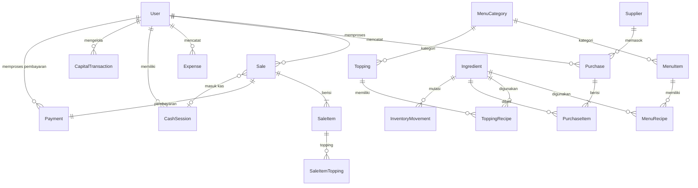

# Dokumentasi Skema Database Kasir Seblak Prasmanan

Aplikasi **Kasir Seblak Prasmanan** menggunakan basis data **PostgreSQL** yang dimigrasikan menggunakan **Prisma ORM**.

## Diagram Entitas Utama

## Tabel & Model

### 1. `User`
- `id` (CUID, PK)
- `email` (String, Unique)
- `name` (String)
- `passwordHash` (String, bcrypt)
- `role` (Enum: `OWNER`, `CASHIER`)
- `isActive` (Boolean, default `true`)

### 2. `StoreSettings`
- `name` (String, nama usaha)
- `address`, `phone` (String, kontak outlet)
- `timezone` (String, default `Asia/Jakarta`)

### 3. `MenuItem` & `Topping`
- Menyimpan menu porsi dasar seblak, minuman, dan item topping prasmanan (kerupuk, bakso, sosis, dumpling, sayuran, dll).
- Terhubung dengan `MenuRecipe` dan `ToppingRecipe` ke bahan baku (`Ingredient`).

### 4. `Ingredient` (Inventaris Bahan Baku)
- `stock`: Stok fisik riil tersedia.
- `minStock`: Batas minimum untuk peringatan bahan menipis.
- `avgCost`: HPP rata-rata bergerak (*Weighted Average Cost*).

### 5. `InventoryMovement`
- Mencatat seluruh riwayat mutasi stok dengan tipe: `PURCHASE`, `SALE`, `SALE_REVERSAL`, `WASTE`, `ADJUSTMENT_IN`, `ADJUSTMENT_OUT`.

### 6. `Purchase` & `PurchaseItem`
- Belanja bahan baku dari supplier. Saat pembelian dicatat, stok otomatis bertambah dan `avgCost` dihitung ulang.

### 7. `Sale`, `SaleItem`, & `SaleItemTopping`
- Transaksi penjualan kasir. Setiap porsi seblak menyimpan pilihan level pedas, kuah, serta topping prasmanan yang dipilih beserta snapshot harga dan HPP-nya.
- `saleNumber` dan `clientRequestId` unik untuk mencegah transaksi/pembayaran ganda.
- Status: `COMPLETED`, `CANCELLED`, `REFUNDED`. Data transaksi keuangan tidak dihapus permanen.

### 8. `Payment`
- Mencatat pembayaran manual dengan metode `CASH` atau `QRIS`.
- Kolom: `saleId` (unik), `paymentMethod`, `amount`, `amountReceived`, `changeAmount`, `status`, `paidAt`, `cashierId`, `createdAt`, `updatedAt`.
- Status: `PAID`, `CANCELLED`, `REFUNDED`.
- `amountReceived` dan `changeAmount` hanya diisi untuk CASH; QRIS menyimpan `NULL`.
- Tidak ada field payment gateway, QR code, webhook, atau kredensial eksternal.

### 9. `CashSession`
- Shift kasir, mencatat modal awal, uang masuk penjualan tunai, pengeluaran kas tunai, uang fisik aktual yang dihitung, dan selisih kas.

### 10. `Expense` & `CapitalTransaction`
- Pengeluaran operasional dan pencatatan modal/prive pemilik.
