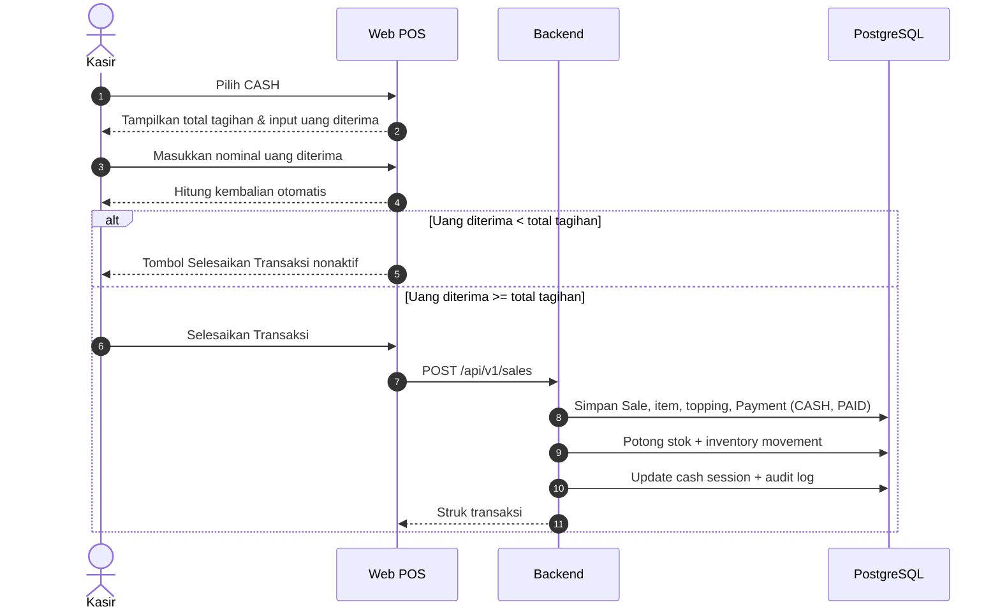
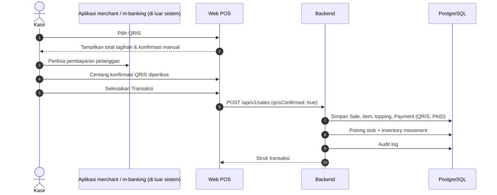

# Pencatatan Pembayaran CASH & QRIS

Sistem Kasir Seblak Prasmanan hanya mengenal dua metode pembayaran: **CASH** dan **QRIS**. Keduanya adalah label pencatatan manual. Sistem tidak memproses pembayaran elektronik dan tidak berkomunikasi dengan layanan eksternal.

## Prinsip

- Tidak ada payment gateway (Midtrans, Xendit, atau lainnya).
- Tidak ada QRIS dinamis, QR code generator, webhook, polling status, atau verifikasi otomatis.
- Tidak ada API key/merchant credential pembayaran di frontend, backend, database, maupun environment variables.
- QRIS hanya dicatat setelah kasir memeriksa pembayaran pelanggan secara manual di luar aplikasi.

## Alur CASH



Rumus:

```text
Kembalian = Uang diterima - Total tagihan
```

## Alur QRIS



Pada QRIS, `amountReceived` dan `changeAmount` disimpan sebagai `NULL`. Tidak ada permintaan nominal uang diterima dan tidak ada QR code yang dibuat aplikasi.

## Struktur Tabel Payment

| Kolom | Keterangan |
| :--- | :--- |
| `id` | Primary key |
| `saleId` | Relasi unik ke `Sale` (satu pembayaran per transaksi) |
| `paymentMethod` | Enum `CASH` / `QRIS` |
| `amount` | Total tagihan yang dibayar |
| `amountReceived` | Nominal uang diterima (hanya CASH) |
| `changeAmount` | Kembalian (hanya CASH) |
| `status` | Enum `PAID` / `CANCELLED` / `REFUNDED` |
| `paidAt` | Waktu pembayaran dikonfirmasi |
| `cashierId` | Kasir yang memproses pembayaran |
| `createdAt`, `updatedAt` | Timestamp audit |

## Integritas

- `Payment.saleId` unik sehingga satu transaksi tidak dapat memiliki dua pembayaran.
- `Sale.clientRequestId` unik mencegah klik ganda membuat transaksi kedua.
- `Sale.saleNumber` unik.
- Seluruh proses penyimpanan menggunakan satu database transaction.
- Pembatalan/refund tidak menghapus data. Status transaksi dan pembayaran diubah, stok dikembalikan, dan aksi dicatat pada `AuditLog`.
